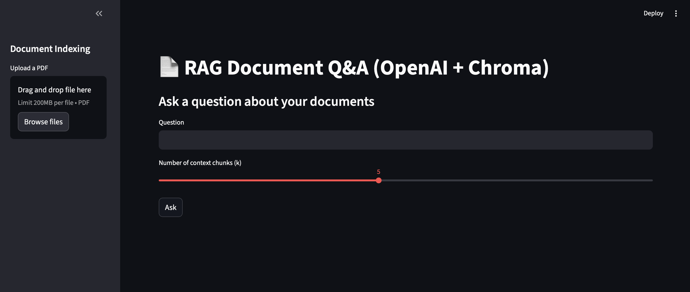
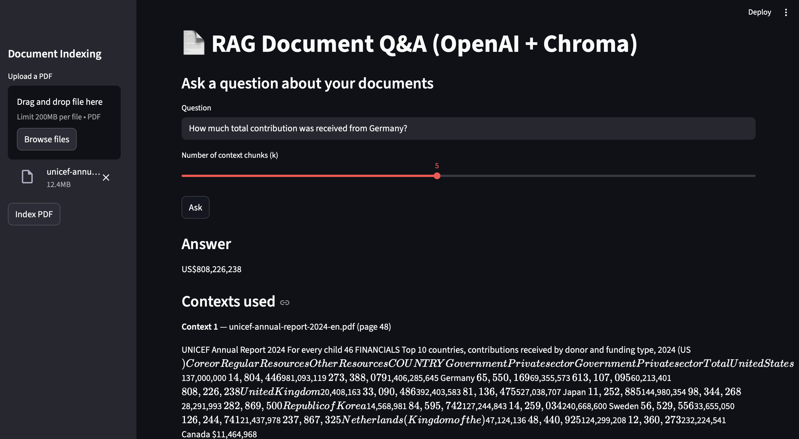

# 📄 RAG Document Q&A (OpenAI + Chroma)

End-to-end **Retrieval‑Augmented Generation (RAG)** system that lets you upload long PDFs (e.g. annual reports) and ask natural-language questions about their content.  
Under the hood it uses **OpenAI GPT-5 mini** for generation, **sentence-transformers** for embeddings, and **ChromaDB** for vector search, all wrapped in a **FastAPI** backend and a **Streamlit** UI.



---

## ✨ What this project demonstrates

This repository is meant to show a realistic LLM application, not just a single script:

- **RAG pipeline**: document parsing → chunking → embeddings → vector store → retrieval → LLM answer.
- **Backend service**: production-style **FastAPI** API with `/index` and `/ask` endpoints.
- **Frontend UI**: simple but clean **Streamlit** app for non-technical users.
- **OpenAI integration**: uses `gpt-5-mini` via the official OpenAI Python SDK.
- **Dockerized backend**: FastAPI service can run fully containerized.
- **Realistic use case**: querying a long PDF like the **UNICEF Annual Report** for concrete facts and summaries.

---

## 🧱 Tech Stack

| Component         | Technology                                 |
|-------------------|---------------------------------------------|
| LLM               | OpenAI `gpt-5-mini`                         |
| Embeddings        | `sentence-transformers/all-MiniLM-L6-v2`    |
| Vector Database   | [ChromaDB](https://www.trychroma.com/)      |
| Backend           | [FastAPI](https://fastapi.tiangolo.com/) + [Pydantic](https://docs.pydantic.dev/) |
| Frontend          | [Streamlit](https://streamlit.io/)          |
| PDF parsing       | `pypdf`                                     |
| Containerization  | Docker                                      |
| Config            | `.env` via `python-dotenv`                  |

---

## 📂 Project structure

```text
llm-rag-document-chatbot/
├── app/
│   ├── main.py              # FastAPI app: /health, /index, /ask
│   └── models.py            # Pydantic request/response models
├── core/
│   ├── embeddings.py        # EmbeddingModel wrapper (MiniLM)
│   ├── vector_store.py      # ChromaDB wrapper
│   ├── document_loader.py   # PDF loader + text chunker
│   └── rag_pipeline.py      # RAGPipeline orchestrating everything
├── ui/
│   └── app.py               # Streamlit UI
├── assets/
│   ├── app_ui.png           # UI screenshot
│   └── output.png           # Example Q&A screenshot
├── chroma_db/               # (created at runtime, persisted vector store)
├── tmp/                     # (uploaded PDFs at runtime)
├── .env.example             # env template (no secrets)
├── requirements.txt
├── Dockerfile               # backend container
└── README.md
```

---

## ⚙️ Setup

1. **Clone the repo**

   ```bash
   git clone https://github.com/mtaha-ai/llm-rag-document-chatbot.git
   cd llm-rag-document-chatbot
   ```

2. **Python version**

   Use Python 3.11 (same as the Docker image). You can create a virtual environment with:

   ```bash
   python3.11 -m venv .venv
   source .venv/bin/activate      # macOS / Linux
   # .venv\Scripts\activate       # Windows
   ```

3. **Install dependencies**

   ```bash
   pip install --upgrade pip
   pip install -r requirements.txt
   ```

4. **Environment variables**

   Create a real `.env` file from the template:

   ```bash
   cp .env.example .env
   ```

   Edit `.env` and set your OpenAI key and preferred model:

   ```
   OPENAI_API_KEY=sk-...your-real-key-here...
   OPENAI_MODEL=gpt-5-mini
   ```

   ⚠️ Do **not** commit `.env` – keep it local. `OPENAI_API_KEY` must not be quoted and must start with `sk-`.

---

## 🚀 Running locally (no Docker)

You’ll run:

- FastAPI backend on port 8000
- Streamlit UI on port 8501

1. **Start the FastAPI backend**

   From the project root:

   ```bash
   uvicorn app.main:app --reload
   ```

   Check it:

   - Health: <http://localhost:8000/health>
   - API docs: <http://localhost:8000/docs>

2. **Start the Streamlit UI**

   In a second terminal (same virtual environment, same folder):

   ```bash
   streamlit run ui/app.py
   ```

   Streamlit will launch at: <http://localhost:8501>

---

## 🐳 Running the backend in Docker

1. **Build the image**

   ```bash
   docker build -t rag-api .
   ```

2. **Run the container (using your local .env)**

   ```bash
   docker run -p 8000:8000 --env-file .env rag-api
   ```

   The backend is now available at <http://localhost:8000>.

3. **Run Streamlit locally as before**

   ```bash
   streamlit run ui/app.py
   ```

   The UI is unchanged; it talks to the Dockerized backend via `API_URL = "http://localhost:8000"`.

---

## 💡 How it works (RAG flow)

1. **Indexing a document**

   - In the Streamlit sidebar, upload a PDF (e.g., UNICEF Annual Report 2024).
   - Click **“Index PDF”**.
   - The backend will:
     - Parse the PDF pages using `pypdf`.
     - Chunk text into overlapping segments.
     - Create embeddings with `all-MiniLM-L6-v2`.
     - Store them in a ChromaDB collection (`chroma_db/` on disk).

2. **Asking a question**

   - Type a question in the main panel, e.g.,:

     > How much total contribution was received from Germany?

   - Choose how many context chunks to retrieve (`k`).
   - Click **“Ask”**.
   - The backend will:
     - Embed the question.
     - Retrieve top‑k similar chunks from ChromaDB.
     - Build a prompt with those chunks as context.
     - Call `gpt-5-mini` with that prompt.
     - Return the final answer plus the exact context snippets used.

Here’s an example of the output for a financial question on the UNICEF report:



The “Contexts used” section shows exactly which document chunks and pages were used to answer the question, giving transparency and grounding.

---

## 🧪 Example questions to try

Once your PDF is indexed, you can ask:

- Give a short summary.
- What are the main goals described in this report?
- What key challenges does UNICEF highlight?
- How much total contribution was received from Germany?
- Which regions were prioritized?
- Summarize the education-related actions.
- What results were achieved this year?

---

## 📌 Notes & Limitations

- This project uses OpenAI’s paid API – you need your own API key and billing set up.
- Only PDF files are supported out of the box (via `pypdf`), but `document_loader.py` can be extended for other formats.
- Tables in PDFs are treated as text; very complex layouts may extract noisily.
- RAG quality depends on:
  - Chunking strategy
  - Embedding model
  - Choice of `k` (number of retrieved chunks)

