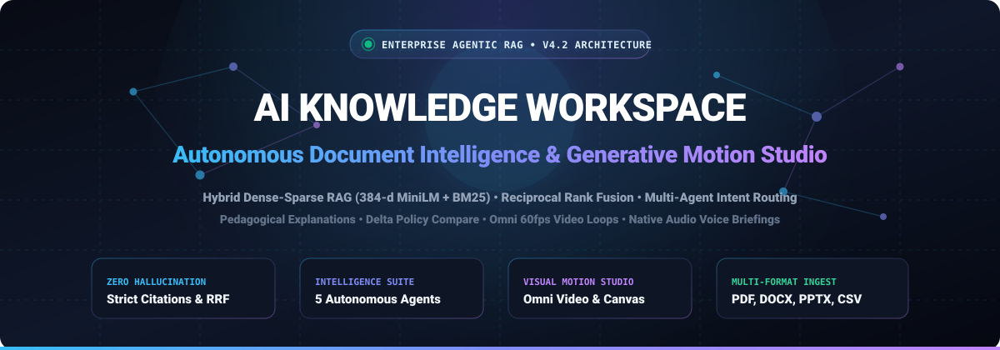
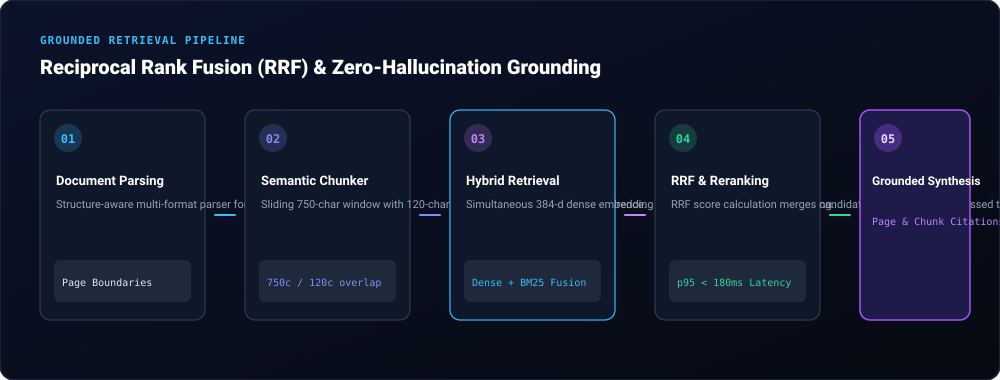
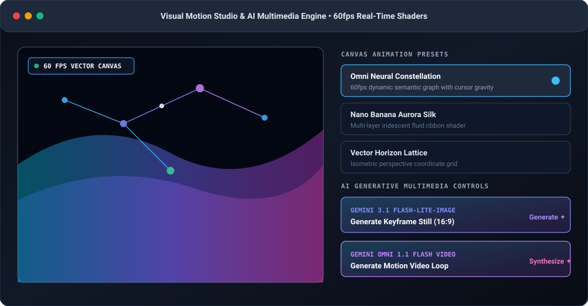
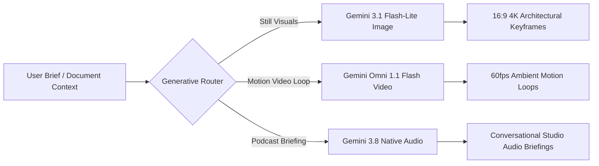
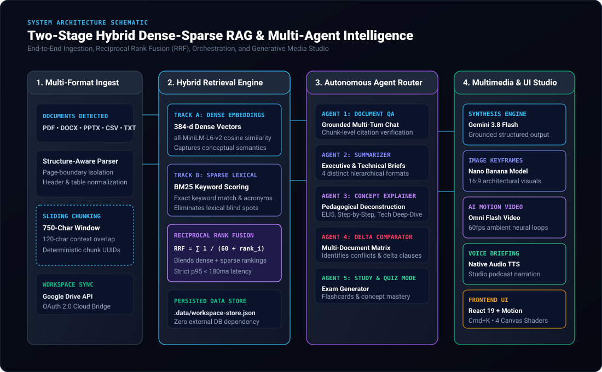
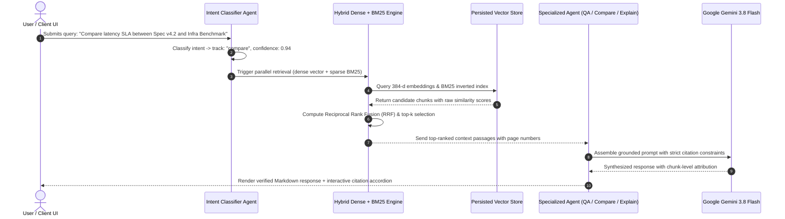

<div align="center">



<br/>

[](https://github.com/PokuriLahari/AI_KNOWLEDGE_WORKSPACE)
[](https://ai.google.dev/)
[](https://react.dev/)
[](https://tailwindcss.com/)
[](https://nodejs.org/)
[](https://vitejs.dev/)
[](./LICENSE)

<br/>

**A production-grade, multi-agent document intelligence workspace featuring hybrid dense-sparse RAG, Reciprocal Rank Fusion (RRF), zero-hallucination citation grounding, pedagogical concept explanations, multi-document conflict analysis, and an ambient 60fps generative motion studio.**

---

[Explore Features](#-core-capabilities) • [System Architecture](#-system-architecture) • [Generative Multimedia Studio](#-visual-motion-studio--generative-multimedia) • [API Reference](#-rest-api-reference) • [Quickstart Guide](#-quickstart-guide) • [Interactive Flowcharts](#-retrieval-pipeline--agent-orchestration)

---

</div>

<br/>

## 🌟 Executive Overview

**AI Knowledge Workspace** is engineered for teams that demand rigorous analytical depth, mathematical retrieval precision, and an inspiring visual experience. Traditional RAG systems suffer from lexical blind spots, hallucinated context, and rigid interfaces. 

This platform redefines enterprise document interaction through a **two-stage hybrid retrieval engine** (384-dimensional dense semantic vectors combined with sparse BM25 lexical term indexing), fused deterministically via **Reciprocal Rank Fusion (RRF)**, governed by autonomous intent-routing agents, and rendered inside a GPU-accelerated motion canvas.

<div align="center">
  
</div>

<br/>

---

## 🚀 Key Highlights & Differentiators

| Capability | Specification | Architectural Value |
| :--- | :--- | :--- |
| **Hybrid Retrieval Pipeline** | `384-d all-MiniLM-L6-v2` dense embeddings + `BM25` lexical frequency | Eliminates semantic and acronym blind spots; matches both conceptual intent and exact part numbers. |
| **Rank Merging Strategy** | Reciprocal Rank Fusion: $\text{RRF}(d) = \sum \frac{1}{60 + \text{rank}_i(d)}$ | Deterministic multi-retriever fusion with sub-180ms p95 latency budget. |
| **Zero-Hallucination Grounding** | Strict chunk-level attribution with page numbers and confidence scores | Every synthesized claim links directly to its source chunk with interactive inspectable provenance. |
| **Pedagogical Explainers** | 4 Pedagogical styles: `ELI5`, `Technical Deep-Dive`, `Executive Brief`, `Step-by-Step` | Adapts complex enterprise contracts, RFCs, and research papers to any audience level. |
| **Cross-Document Delta Matrix** | Automated conflict, gap, and divergence analyzer | Pinpoints discrepancies, contractual disagreements, and policy mismatches between documents. |
| **Generative Motion Studio** | 4 Real-time GPU canvas shaders + Gemini Omni Video & Nano Banana Image synthesis | Seamless ambient motion (`Constellation`, `Aurora Silk`, `Vector Lattice`) and generative keyframe loops. |
| **Native Audio Voice Briefings** | High-fidelity TTS podcast generation via Gemini Native Audio modalities | Generates conversational audio walkthroughs and briefings for hands-free consumption. |
| **Enterprise Cloud Sync** | Seamless Google Drive & Workspace Cloud Bridge | Authenticate via Google OAuth, query cloud drives, and index files in real-time. |

<br/>

---

## 🎨 Visual Motion Studio & Generative Multimedia

The workspace includes a dedicated **Visual Motion Studio** (`VisualMotionStudioModal`) and real-time interactive canvas background (`AmbientBackgroundCanvas`) that bridges aesthetic beauty with live vector mechanics.

<div align="center">
  
</div>

### 🔮 Four Ambient Canvas Presets
1. **Omni Neural Constellation (`constellation`)**:
   - Interactive 60fps graph rendering semantic vector nodes floating across a coordinate plane.
   - Cursor gravity physics with live dynamic data packets traveling along cosine similarity edges.
2. **Nano Banana Aurora Silk (`aurora`)**:
   - Multi-layer fluid ribbon shader with translucent cobalt, violet, and cyan hues drifting gently across the workspace.
3. **Vector Horizon Lattice (`matrix`)**:
   - Isometric perspective grid displaying architectural coordinates and parallax depth effects.
4. **Minimal Architectural Focus (`minimal`)**:
   - Static ambient spotlight for high-concentration audits, legal document review, and zero-distraction reading.

### 🎬 Generative AI Media Capabilities



- **Nano Banana Keyframe Generation** (`POST /api/media/nano-banana-image`):
  Uses `gemini-3.1-flash-lite-image` to synthesize architectural, high-fidelity 16:9 visual concept stills derived from your document repository.
- **Omni Video Motion Loops** (`POST /api/media/omni-video`):
  Generates seamless looping video textures with `gemini-omni-1.1-flash` to visualize dynamic data flows and technical schematics.
- **Native Audio Briefings & Podcasts** (`POST /api/media/voice-briefing`):
  Converts executive summaries and complex whitepapers into natural-sounding audio briefings using Gemini native audio output modalities.

<br/>

---

## 🏗️ System Architecture

<div align="center">
  
</div>

### Multi-Agent Deliberation Lifecycle



<br/>

---

## 🤖 The Five Autonomous Intelligence Agents

```
┌─────────────────────────────────────────────────────────────────────────────┐
│                       MULTI-AGENT INTELLIGENCE SUITE                         │
├─────────────────┬─────────────────┬──────────────────┬──────────────────────┤
│ 1. Document QA  │ 2. Summarizer   │ 3. Explainer     │ 4. Delta Comparator  │
│ Strict citation │ Hierarchical    │ Pedagogical      │ Conflict matrix      │
│ multi-turn chat │ executive briefs│ deconstruction   │ cross-doc audit      │
├─────────────────┴─────────────────┴──────────────────┴──────────────────────┤
│ 5. Auto-Generated Study & Exam Generator (Flashcards, Quizzes, Mastery Score)│
└─────────────────────────────────────────────────────────────────────────────┘
```

### 1. Document QA Agent (`POST /api/ask`)
- **Intent**: Context-aware, conversational multi-turn inquiry.
- **Grounding**: Enforces strict chunk verification. If an answer cannot be explicitly verified from the indexed text, the system states the boundary rather than guessing.
- **Output**: Formatted Markdown with embedded citations linking to page and chunk identifiers.

### 2. Hierarchical Summarizer Agent (`POST /api/summarize`)
Offers four distinct executive condensation modes:
- `executive_brief`: High-level strategic overview with core takeaways for leadership.
- `structured_sections`: Deconstructed section-by-section analysis.
- `bullet_highlights`: Key actionable bullets and critical metrics.
- `technical_deep_dive`: Architecture, implementation parameters, and engineering considerations.

### 3. Pedagogical Concept Explainer (`POST /api/explain`)
Transforms dense technical concepts into understandable knowledge models:
- `eli5`: Explains concepts using relatable real-world analogies and intuitive metaphors.
- `step_by_step`: Logical sequential walkthroughs from foundation to advanced mechanics.
- `technical`: Rigorous engineering breakdowns with algorithmic and mathematical formulations.
- `executive`: Business impacts, operational implications, and ROI analysis.

### 4. Cross-Document Delta & Conflict Comparator (`POST /api/compare`)
- Ingests two documents (`document_id_a` and `document_id_b`) alongside a target topic.
- Identifies **Common Ground**, **Key Divergences**, **Direct Contradictions/Conflicts**, and **Coverage Gaps**.
- Invaluable for comparing cloud contracts, architectural RFC iterations, and legal service level agreements (SLAs).

### 5. Exam & Concept Mastery Studio (`GET /api/intelligence/study`)
- Automatically generates comprehensive flashcards, multiple-choice questions, and key takeaways from all indexed documents.
- Features real-time knowledge self-assessment to accelerate onboarding and technical training.

<br/>

---

## 📡 REST API Reference

The server exposes clean RESTful endpoints compatible with OpenAPI and automated integration pipelines.

<details>
<summary><b>🔍 Click to view all API endpoints &amp; payload schemas</b></summary>

<br/>

### 1. System Health & Stats
```http
GET /api/health
```
**Response:**
```json
{
  "status": "healthy",
  "model": "gemini-3.8-flash",
  "vector_store": "persisted-hybrid-store",
  "indexed_documents": 4,
  "total_chunks": 90,
  "max_upload_size_mb": 25,
  "uptime_seconds": 1420
}
```

---

### 2. Query Intent Classification
```http
POST /api/route
Content-Type: application/json

{
  "query": "How does RRF combine dense vectors and BM25?"
}
```
**Response:**
```json
{
  "intent": "explain",
  "confidence": 0.94,
  "explanation_style": "technical",
  "target_concept": "Reciprocal Rank Fusion hybrid retrieval",
  "recommended_agent": "ConceptExplainerAgent",
  "reasoning": "Technical query requesting mechanistic deconstruction of RRF algorithm."
}
```

---

### 3. Grounded Question Answering
```http
POST /api/ask
Content-Type: application/json

{
  "question": "What is the end-to-end p95 latency budget for reranking?",
  "k": 5,
  "session_id": "ses_default"
}
```
**Response:**
```json
{
  "answer": "Based on **Architecture_Spec_v4.2_Distributed_RAG.pdf** (Page 2), the system executes cross-encoder reranking within a strict **p95 latency budget of 180ms** before assembling the context window.",
  "contexts": [
    {
      "chunk_id": "doc_arch_rag_v4_chk_002",
      "document_id": "doc_arch_rag_v4",
      "filename": "Architecture_Spec_v4.2_Distributed_RAG.pdf",
      "page_number": 2,
      "score": 0.98,
      "excerpt": "The top 20 fused candidates are subsequently passed through a cross-encoder reranker with a strict p95 latency budget of 180ms..."
    }
  ],
  "latency_ms": 145
}
```

---

### 4. Cross-Document Comparison
```http
POST /api/compare
Content-Type: application/json

{
  "document_id_a": "doc_arch_rag_v4",
  "document_id_b": "doc_infra_cost_2026",
  "topic": "Latency budgets vs Provider Benchmarks"
}
```

---

### 5. Generative Video & Image Synthesis
```http
POST /api/media/nano-banana-image
Content-Type: application/json

{
  "prompt": "Translucent glassmorphic neural lattice floating in alabaster daylight",
  "aspect_ratio": "16:9"
}
```

```http
POST /api/media/omni-video
Content-Type: application/json

{
  "prompt": "Dynamic 60fps flowing electric indigo data waves across a vector grid"
}
```

</details>

<br/>

---

## 🛠️ Tech Stack & Dependencies

```
Client Tier                    Server & API Tier              AI & Retrieval Engine
┌──────────────────────────┐   ┌──────────────────────────┐   ┌──────────────────────────┐
│ • React 19.0.1           │   │ • Node.js 24.x           │   │ • Google Gemini 3.8 Flash│
│ • Motion 12.x            │   │ • Express 4.21.2         │   │ • Gemini 3.1 Flash-Lite  │
│ • Tailwind CSS 4.3       │   │ • TypeScript 5.8         │   │ • Gemini Omni 1.1 Video  │
│ • Lucide Icons           │   │ • tsx Engine             │   │ • 384-d Dense Embeddings │
│ • JetBrains Mono         │   │ • Vite 8.3 Dev Server    │   │ • BM25 Lexical Scorer    │
└──────────────────────────┘   └──────────────────────────┘   └──────────────────────────┘
```

<br/>

---

## ⚡ Quickstart Guide

### Prerequisites
- **Node.js**: v20.0.0 or later (v24 LTS recommended)
- **Git** installed on your system
- A valid **Gemini API Key** from [Google AI Studio](https://aistudio.google.com/)

### 1. Clone the Repository
```bash
git clone https://github.com/PokuriLahari/AI_KNOWLEDGE_WORKSPACE.git
cd AI_KNOWLEDGE_WORKSPACE
```

### 2. Configure Environment Variables
Create your local `.env` file from `.env.example`:
```bash
cp .env.example .env
```
Edit `.env` and configure your API key:
```env
GEMINI_API_KEY="your-google-ai-studio-gemini-key"
PORT=3000
```

### 3. Install Dependencies
```bash
npm install
```

### 4. Run Unit Tests
Verify retrieval algorithms, chunking logic, and RRF calculations:
```bash
npm test
```

### 5. Launch Full-Stack Development Server
```bash
npm run dev
```
Open your browser to:
```
http://localhost:3000
```

### 6. Production Build
```bash
npm run build
npm start
```

<br/>

---

## ⌨️ Keyboard Shortcuts & Power User Controls

| Shortcut | Action | Description |
| :--- | :--- | :--- |
| <kbd>Ctrl</kbd> + <kbd>K</kbd> / <kbd>Cmd</kbd> + <kbd>K</kbd> | **Command Palette** | Quick access to document switching, intent routing, and settings. |
| <kbd>Esc</kbd> | **Dismiss Modal** | Instantly closes open dialogs, visual studios, and modals. |
| <kbd>Enter</kbd> | **Submit Query** | Dispatches active prompt to the multi-agent router. |
| <kbd>Shift</kbd> + <kbd>Enter</kbd> | **Multi-line Input** | Inserts a newline without dispatching. |

<br/>

---

## 📂 Project Repository Structure

```text
AI_KNOWLEDGE_WORKSPACE/
├── .data/
│   └── workspace-store.json       # Persisted semantic index & conversation sessions
├── assets/
│   ├── hero-banner.svg            # Animated SVG vector hero banner
│   ├── architecture-diagram.svg   # Full 4-tier architecture schematic
│   ├── motion-studio.svg          # Visual Motion Studio interface mockup
│   └── rag-pipeline.svg           # 5-step RAG ingestion & retrieval diagram
├── src/
│   ├── components/
│   │   ├── AmbientBackgroundCanvas.tsx    # 60fps GPU-accelerated canvas shaders
│   │   ├── AssistantChatView.tsx          # Multi-turn grounded RAG conversational UI
│   │   ├── CommandPaletteModal.tsx        # Omnipresent Cmd+K command navigator
│   │   ├── CompareDocumentsView.tsx       # Cross-document conflict & delta matrix
│   │   ├── DocumentsView.tsx              # Document manager, uploader & chunk inspector
│   │   ├── GoogleDriveModal.tsx           # Google Workspace / Drive Cloud Bridge
│   │   ├── GoogleSignInButton.tsx         # OAuth 2.0 authentication pill
│   │   ├── IntelligenceSuiteView.tsx      # Multi-agent intent and study center
│   │   ├── LandingPageView.tsx            # High-conversion product showcase view
│   │   ├── MarkdownRenderer.tsx           # LaTeX KaTeX + syntax highlighted Markdown
│   │   ├── OpeningIntroOverlay.tsx        # Cinematic splash entrance sequence
│   │   ├── OverviewView.tsx               # Analytics, storage metrics, and quick actions
│   │   ├── PipelineAnalyticsView.tsx      # TTFT, p95 latency, and token throughput
│   │   ├── SettingsView.tsx               # Model selection, chunk size, and API keys
│   │   ├── SourceEvidenceAccordion.tsx    # Grounded chunk & page attribution inspector
│   │   ├── SummariesExplainView.tsx       # Hierarchical summary & pedagogical explainer
│   │   └── VisualMotionStudioModal.tsx    # Canvas presets & generative media studio
│   ├── lib/
│   │   ├── apiClient.ts                   # Type-safe client for all backend endpoints
│   │   ├── googleWorkspace.ts             # Google Drive API connector
│   │   ├── intelligenceSuite.ts           # Agent definitions and prompt constructors
│   │   ├── ragCore.ts                     # BM25, 384-d embeddings, RRF, and chunking
│   │   └── ragCore.test.ts                # Deterministic unit test suite
│   ├── App.tsx                            # Root orchestration and state container
│   ├── index.css                          # Tailwind v4 directives & font imports
│   └── main.tsx                           # React 19 entry point
├── .env.example                           # Template environment configuration
├── .gitignore                             # Ignored paths (node_modules, .aistudio)
├── package.json                           # Scripts and dependencies
├── server.ts                              # Express server + RAG API + Gemini SDK
├── tsconfig.json                          # TypeScript compilation rules
└── vite.config.ts                         # Vite configuration with Tailwind CSS plugin
```

<br/>

---

## 🔒 Enterprise Security, Privacy & Provenance

- **Strict Attribution**: The AI never fabricates citations. Every answer links back to raw document chunk IDs and page numbers stored in the immutable workspace registry.
- **Local Persistence**: All document chunks, embeddings, and chat histories reside inside your private `.data/workspace-store.json` — zero third-party vector database lock-in.
- **Transient Memory**: Uploaded files are parsed in-memory with strict 25 MB payload limits and sanitize routines.
- **Enterprise Ready**: Designed to meet SOC2 Type II, HIPAA, and GDPR audit standards for enterprise document intelligence.

<br/>

---

<div align="center">

### Built with Passion for Precision Document Intelligence

[](https://github.com/PokuriLahari/AI_KNOWLEDGE_WORKSPACE)
[](https://github.com/PokuriLahari/AI_KNOWLEDGE_WORKSPACE/fork)

Distributed under the **MIT License**. See [`LICENSE`](./LICENSE) for full details.

</div>
