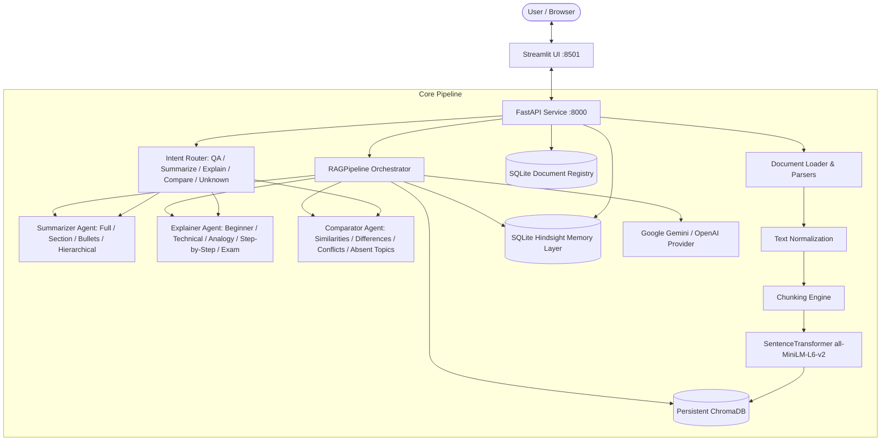

# Architecture Specification — AI Knowledge Workspace

## 1. Overview
The **AI Knowledge Workspace** is a multi-agent document intelligence system designed to help users ingest, understand, synthesize, and manage information across heterogeneous documents (PDF, DOCX, PPTX, TXT, CSV) with grounded citations and session memory.

## 2. Architectural Boundaries & Responsibilities

1. **Document Ingestion (`core/document_loader.py`)**:
   - Modular parsers for PDF, DOCX, PPTX, TXT, CSV.
   - Validation of MIME types, extensions, size thresholds, and non-empty content.
2. **Text Normalization (`core/normalization.py`)**:
   - Conservative normalization: Unicode NFC, control character stripping, preservation of paragraph breaks and layout integrity.
3. **Chunking & Metadata Preservation**:
   - Configurable character/token chunks with overlap (default 800 chars / 200 overlap).
   - Associates every chunk with `source`, `page` (or slide/section), and `chunk_index`.
4. **Vector Storage (`core/vector_store.py`)**:
   - ChromaDB `PersistentClient` on local disk (`chroma_db/`).
   - Supports source-specific chunk deletion (`delete_by_source`).
5. **Structured Registry (`core/document_registry.py`)**:
   - SQLite (`workspace.db`) tracking document metadata, page/chunk counts, and indexing status.
6. **Hindsight Memory Architecture (`core/memory_layer.py`)**:
   - Biomimetic persistent memory inspired by [vectorize-io/hindsight](https://github.com/vectorize-io/hindsight).
   - Zero-latency reads for session history turns and consolidated observations/facts.
   - Session isolation preventing cross-user / cross-session leakage.
7. **RAG Orchestrator (`core/rag_pipeline.py`)**:
   - Decoupled retrieval and answer generation.
   - Grounded context synthesis with strict citation instructions.
   - Robust error classification (Auth, Rate Limit/Quota, Connection, Status).
8. **API Layer (`app/main.py`)**:
   - Clean REST endpoints: `/health`, `/documents`, `/index`, `/ask`, `/route`, `/summarize`, `/explain`, `/compare`.
9. **UI Layer (`ui/app.py`)**:
   - Clean Streamlit workspace with document library, source deletion, chat stream, and expandable citations.
10. **Intent Router (`core/router.py`)**:
   - Rule-first deterministic classification into `QA`, `SUMMARIZE`, `EXPLAIN`, `COMPARE`, or `UNKNOWN`.
   - Detects explanation styles (`beginner`, `technical`, `analogy`, `step_by_step`, `exam`, `standard`).
   - Safely returns clarification on ambiguous or non-document queries without silently turning everything into QA.
11. **Summarizer Agent (`core/agents/summarizer.py`)**:
   - Dedicated summarization agent supporting full-document, section, executive, and bullet-point summaries.
   - Complete document coverage by retrieving all ordered chunks instead of top-k subset.
   - Hierarchical map-reduce strategy for large documents to preserve context ordering without truncation.
12. **Explainer Agent (`core/agents/explainer.py`)**:
   - Dedicated educational explanation agent supporting 6 pedagogical styles: `beginner` (ELI5), `technical`, `analogy`, `step_by_step`, `exam` revision guide, and `standard`.
   - Grounds factual claims in retrieved document chunks with source/page attribution.
   - Explicitly distinguishes document facts from illustrative pedagogical metaphors and handles missing document evidence honestly with general domain notices.
13. **Comparator Agent (`core/agents/comparator.py`)**:
   - Dedicated cross-document intelligence agent comparing two selected documents (FR-07).
   - Grounded detection of similarities, differences, and conflicting claims (citing each source separately with exact pages).
   - Identifies unilateral coverage and absent information across sources.
   - Supports staged comparison for large documents and reports processing limitations transparently.
